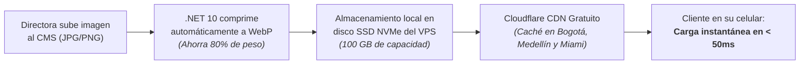
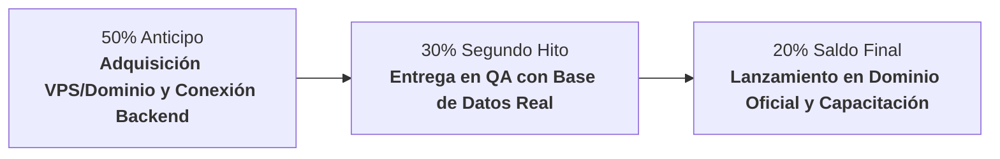

# 📋 Propuesta Económica, Cotización de Desarrollo y Plan de Despliegue
## Plataforma Web E-Commerce Luxury, CRM y CMS — Yanbal Prestige

**Documento Oficial para:** Directora Yuli & Equipo de Consultoras Independientes  
**Líder Técnico & Arquitectura:** Brayan Stid Cortés Lombana (`bscl`)  
**Estrategia de Infraestructura:** VPS Cloud Anual Multiproyecto + Cloudflare CDN + Frontend Edge  
**Fecha de Actualización:** Octubre de 2026  
**Moneda de Referencia:** Pesos Colombianos (COP) con equivalencia en Dólares (USD, TRM estimada $4.100 COP)  
**Validez de la Oferta:** 30 días calendario  

---

## 🎯 1. Resumen Ejecutivo y Alcance de la Solución

El proyecto **Yanbal Prestige** es una **infraestructura digital integral de ventas y gestión** de alta velocidad diseñada para potenciar la fuerza comercial de la red de consultoras liderada por la Directora Yuli. 

Bajo la premisa de **máxima velocidad de carga al menor costo operativo del mercado**, la solución integra:
1. **Tienda E-Commerce Luxury (Pública):** Catálogo interactivo de alta cosmética con efecto *Shimmer Skeleton* (cero pantallas parpadeantes), vista de producto dedicada (**PDP**) con lupa/zoom óptico al 220%, selector de rutinas faciales paso a paso y carrito de compras sin fricción con despacho consolidado a WhatsApp.
2. **CRM Especializado de Consultoras (Privado):** Sistema de fidelización de clientes para que cada consultora gestione el tipo de piel (seca, grasa, mixta, sensible), preferencias de fragancias y joyería fina, registro de contactos y asesoría directa personalizada.
3. **CMS Administrativo para la Directora (Privado):** Control total e independiente para actualizar banners de inicio, campañas de revista digital, videos de entrenamiento, eventos presenciales/virtuales y administración de catálogo con códigos SKU sin depender de programadores.
4. **Backend Enterprise & Seguridad Defensiva (.NET 10 + MySQL):** API robusta con arquitectura anti-bots (trampa invisible Honeypot), control de saturación (*Rate Limiting*), recuperación de claves con PIN OTP de seguridad y cumplimiento estricto de la **Ley 1581 de 2012 de Habeas Data (Colombia)**.

---

## 🚀 2. Estrategia Ganadora de Infraestructura: "Máxima Velocidad, Mínimo Costo"

Para cumplir el objetivo de tener **la solución más rápida, escalable y económica posible**, adoptamos la arquitectura de **VPS Cloud Anual Multiproyecto**.

### 💡 ¿Por qué un VPS Anual es la mejor decisión técnica y financiera?
1. **Ahorro Masivo por Pago Anual (Descuento hasta del 60%):** Adquirir el VPS por 1 año completo reduce la tarifa mensual a niveles mínimos (~$25.000 a $30.000 COP al mes).
2. **Capacidad Multiproyecto:** Con un VPS de **2 a 4 vCPU, 4 a 8 GB de RAM y 50 a 100 GB SSD NVMe**, no solo corre con soltura la API de .NET 10 y la base de datos MySQL de Yanbal Prestige, sino que queda con espacio suficiente para **alojar otros 3 a 5 proyectos web o bases de datos adicionales** sin pagar un solo peso extra.
3. **Control Total y Cero Bloqueos:** A diferencia de hostings compartidos lentos (cPanel clásico), el VPS cuenta con tecnología de contenedores Docker y Nginx, garantizando aislamiento, seguridad y rendimiento constante a 60 FPS.

---

### 🖼️ Solución para el Almacenamiento de Imágenes (Rápida y 100% Sin Costos Ocultos)

Uno de los mayores dolores de cabeza en los e-commerce es el cobro recurrente por almacenamiento de imágenes en nubes como AWS S3 o Cloudinary. Resolvemos este reto con una arquitectura de 3 pasos **sin costos mensuales adicionales**:



1. **Almacenamiento Local en el VPS:** Las imágenes de catálogo, banners y fotos de clientas se guardan directamente en el disco SSD NVMe del VPS. Con 100 GB de espacio, caben más de **500.000 fotos de productos optimizadas**.
2. **Optimización Automática a Formato WebP:** Cuando la Directora sube una foto pesada desde su celular o cámara (ej. 8 MB), el backend de .NET 10 la procesa y comprime al formato de última generación **WebP** (reduciéndola a solo ~120 KB sin perder ni un detalle de nitidez ni color).
3. **Distribución Global con Cloudflare Edge CDN (Plan Gratuito):** Conectamos el dominio a Cloudflare. La primera vez que un cliente abre un producto, Cloudflare guarda una copia de la imagen en sus servidores de Colombia. Las siguientes visitas cargan en menos de 50 milisegundos directamente desde la memoria de Cloudflare, **ahorrando el 95% del consumo de ancho de banda del VPS**.

---

## 💰 3. Presupuesto Real de Infraestructura (Inversión Primer Año Completo)

La clienta o Directora sabrá con exactitud matemática cuánto cuesta operar la plataforma durante todo el año, sin letras pequeñas:

| Concepto de Infraestructura | Especificación Técnica | Frecuencia de Pago | Costo Estimado (COP) | Equivalente (USD) |
| :--- | :--- | :---: | :---: | :---: |
| **VPS Cloud Anual (Hostinger / Hetzner / Contabo)** | 2–4 vCPU, 4–8 GB RAM, 100 GB SSD NVMe, Docker + Nginx (Soporta múltiples proyectos) | Anual (12 meses) | **$300.000 – $340.000 COP** | ~$75 – $82 USD / año |
| **Dominio Propio `.com` o `.co`** | Registro oficial (ej. `yanbalprestige.com` o `yuliyanbal.co`) en Namecheap / Cloudflare / Hostinger | Anual (12 meses) | **$55.000 – $65.000 COP** | ~$14 – $16 USD / año |
| **Certificados de Seguridad SSL HTTPS** | Cifrado bancario Let's Encrypt Wildcard con auto-renovación | Permanente | **$0 COP** (Gratis) | $0 USD |
| **Red de Distribución CDN y Anti-DDoS** | Cloudflare Edge Network (Caché de imágenes ultra-rápida y blindaje contra ataques) | Permanente | **$0 COP** (Gratis) | $0 USD |
| **Frontend Luxury Hosting** | Vercel Global Edge (Servidores distribuidos para la tienda React 19) | Permanente | **$0 COP** (Gratis) | $0 USD |
| **TOTAL INVERSIÓN INFRAESTRUCTURA (1 AÑO COMPLETO):** | **Todo incluido para operar 365 días + espacio multiproyecto** | **ANUAL** | **~$355.000 – $405.000 COP** | **~$89 – $98 USD** |

> [!TIP]
> **Costo Promedio Mensual Real:**  
> Al dividir los ~$380.000 COP entre los 12 meses del año, el costo operativo de la plataforma es de apenas **~$31.600 COP / mes**.  
> ¡Cuesta menos que un plan de datos móviles y permite alojar tanto Yanbal Prestige como futuros proyectos en el mismo servidor!

---

## 💼 4. Cotización de Desarrollo, Integración y Puesta en Marcha

Se estructuran dos alternativas de contratación transparentes para la Directora Yuli:

```
┌────────────────────────────────────────────────────────────────────────┐
│                   PAQUETES DE IMPLEMENTACIÓN                           │
├───────────────────────────────────┬────────────────────────────────────┤
│  PLAN 1: ESENCIAL DIGITAL         │  PLAN 2: PROFESIONAL INTEGRAL ⭐   │
│  (E-Commerce + WhatsApp + CRM)    │  (Plataforma Completa Llave Mano)  │
│  Inversión: $3.200.000 COP        │  Inversión: $4.900.000 COP         │
│  (~ $780 USD)                     │  (~ $1.195 USD)                    │
└───────────────────────────────────┴────────────────────────────────────┘
```

---

### Detalle de Paquetes

#### 🔹 PLAN 1: "Esencial Digital" — Inversión: $3.200.000 COP (~$780 USD)
*Ideal para arrancar rápido con tienda de alta cosmética y pedidos directos a WhatsApp.*

* **Tienda E-Commerce Luxury:** Catálogo público categorizado (Tratamiento Facial, Maquillaje, Fragancias, Cuidado Personal), buscador en vivo y fichas de producto estándar.
* **Carrito de Compras WhatsApp:** Conversión de pedidos con desglose de productos y total calculado listo para enviar a la consultora.
* **Página de Detalle de Producto (PDP):** Visualización de información de producto, modo de uso clínico e imagen HD.
* **Sección Sé Consultora:** Formulario de captación de prospectos con validación de datos y protección legal Habeas Data (Ley 1581).
* **Despliegue y Puesta en Marcha:** Configuración en el VPS y Vercel con dominio propio y SSL activo.
* **Garantía Técnica:** 30 días de soporte post-entrega ante fallos o ajustes.

---

#### 🌟 PLAN 2: "Profesional Integral Llave en Mano" ⭐ (Recomendado) — Inversión: $4.900.000 COP (~$1.195 USD)
*La plataforma definitiva y 100% autónoma para la Directora Yuli y su red de consultoras.*

* **Todo lo incluido en el Plan 1, más:**
* **PDP de Élite con Lupa / Zoom Óptico 2.2x:** Visor interactivo que amplía la textura y detalles del producto al pasar el cursor o tocar en móvil (estándar Sephora / Apple) a 60 FPS sin retrasos.
* **CRM Privado para Consultoras Independientes:**
  * Base de datos de clientas personalizada por cada consultora.
  * Ficha clínica: tipo de piel (Seca, Grasa, Mixta, Sensible) y preferencias de aromas o joyería fina.
  * Botón directo para iniciar seguimiento en WhatsApp con plantillas predefinidas de asesoría personalizada.
* **CMS Administrativo Editorial Completo (Autonomía 100% para Yuli):**
  * Gestor de Banners y Sliders de campaña (imágenes, textos, enlaces).
  * Gestor de Líneas Emblemáticas (Extracto Divino, Sentiva, Óleo Bio, etc.).
  * Gestor de Revista / Catálogo Digital Interactivo (enlaces de la campaña vigente).
  * Gestor de Video-Tips y Capacitación para su fuerza de ventas.
  * Gestor de Agenda de Eventos y talleres de automaquillaje.
  * Gestor de Catálogo con Códigos SKU, precios de oferta y activación/desactivación instantánea.
* **Backend Enterprise en .NET 10 y MySQL 8:** Persistencia multiusuario robusta, desacoplada y lista para soportar picos de tráfico en fechas de cierre de campaña.
* **Módulo de Optimización de Imágenes WebP en el VPS:** Reducción automática de peso de imágenes para no saturar el almacenamiento ni la velocidad de la tienda.
* **Blindaje de Seguridad y Anti-Bots:**
  * Trampas invisibles Honeypot contra robots y scrapers maliciosos.
  * Límite de peticiones por IP (*Rate Limiting*) para prevenir caídas por saturación.
  * Flujo de Seguridad y Recuperación de Contraseñas mediante PIN OTP temporal supervisado.
* **Arquitectura de Carga Shimmer Skeleton:** Experiencia visual pulida sin parpadeos de contenido durante la navegación.
* **Capacitación y Entrega:** Sesión virtual de 2 horas para capacitar a Yuli y su equipo en el uso del CMS y CRM + Manual de usuario en PDF.
* **Garantía Técnica Extendida:** 60 días de soporte correctivo y acompañamiento en vivo tras el lanzamiento.

---

## 🛠️ 5. Desglose de Esfuerzo de Ingeniería

| Módulo / Fase Técnica | Esfuerzo Estimado | Tarifa Ref. Mercado | Subtotal Equivalente |
| :--- | :---: | :---: | :---: |
| **1. UI/UX Luxury & Frontend React 19:** Maquetación Refero AAA, PDP Zoom 2.2x, Shimmer Skeletons y Responsive Design (Desktop/Móvil). | 35 horas | $50.000 COP / h | $1.750.000 COP |
| **2. CRM Consultoras & Carrito WhatsApp:** Lógica de clientas, perfiles dérmicos, filtros y enlaces dinámicos con plantillas. | 20 horas | $50.000 COP / h | $1.000.000 COP |
| **3. CMS Administrativo & Seguridad Multi-Rol:** Paneles de control para Yuli, gestión de catálogo con SKU, sliders, eventos y videos. | 25 horas | $50.000 COP / h | $1.250.000 COP |
| **4. Backend .NET 10, API REST, Optimización WebP & MySQL:** Kestrel, Entity Framework, migraciones, persistencia, Rate Limiting y Honeypot anti-bots. | 20 horas | $60.000 COP / h | $1.200.000 COP |
| **5. DevOps, Setup VPS Anual Dockerizado, Nginx & Cloudflare:** Configuración del VPS, Docker Compose, Nginx Reverse Proxy, SSL, DNS y CDN. | 10 horas | $60.000 COP / h | $600.000 COP |
| **Total Horas Especializadas / Valor Técnico Base:** | **110 horas** | — | **$5.800.000 COP** |
| **Descuento Comercial de Alianza / Paquete Llave en Mano:** | — | — | **-$900.000 COP** |
| **VALOR FINAL DEL PLAN PROFESIONAL INTEGRAL:** | — | — | **$4.900.000 COP** |

---

## 🛡️ 6. Póliza Opcional de Soporte y Mantenimiento (Mensual)

Una vez cumplidos los **60 días de garantía técnica gratuita**, se ofrece acompañamiento mensual opcional:

* **Plan Soporte & Mantenimiento Preventivo:**  
  **Costo: $380.000 COP / mes (~$92 USD/mes)**
  * Monitoreo de disponibilidad 24/7 (alertas automáticas si el servidor sufre caídas).
  * Verificación periódica y copias de seguridad de la base de datos en almacenamiento secundario.
  * Actualización de parches del sistema operativo del VPS y dependencias.
  * Hasta 4 horas mensuales dedicadas a cambios menores o soporte a consultoras.
  * Soporte técnico prioritario por WhatsApp.

---

## 💳 7. Esquema de Pagos e Hitos de Entrega



1. **50% ($2.450.000 COP) al inicio:** Firma del acuerdo, adquisición del VPS anual y dominio, y despliegue del Backend .NET 10 con MySQL en Docker.
2. **30% ($1.470.000 COP) en validación de pruebas (QA):** Demostración interactiva en el servidor con datos reales de catálogo, CRM y CMS funcionando de extremo a extremo.
3. **20% ($980.000 COP) al lanzamiento oficial:** Vinculación al dominio definitivo (ej. `yanbalprestige.com`), entrega de credenciales maestras, capacitación a Yuli y entrega del manual.

---

## ⏱️ 8. Cronograma de Implementación

* **Semana 1:** Aprovisionamiento del VPS Cloud anual, configuración de Docker, MySQL 8, volumen de almacenamiento para imágenes, conexión del Backend .NET 10 y Nginx.
* **Semana 2:** Integración total entre el Frontend y los endpoints de la API (Catálogo con SKU, guardado real de clientas CRM, carga y optimización WebP de fotos, autenticación y OTP de seguridad).
* **Semana 3:** Vinculación del dominio personalizado oficial, activación de Cloudflare Edge CDN con SSL, pruebas finales de velocidad y sesión de capacitación con la Directora Yuli.
* **Lanzamiento Oficial:** Final de la Semana 3.
