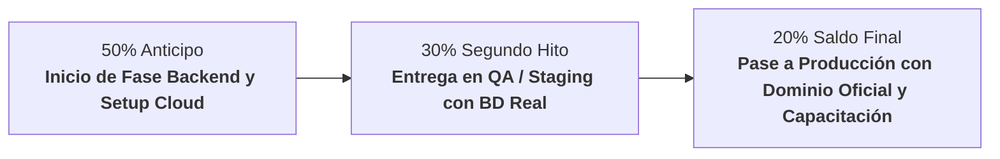

# 📋 Propuesta Económica, Cotización de Desarrollo y Plan de Despliegue
## Plataforma Web E-Commerce Luxury, CRM y CMS — Yanbal Prestige

**Documento Oficial para:** Directora Yuli & Equipo de Consultoras Independientes  
**Líder Técnico & Arquitectura:** Brayan Stid Cortés Lombana (`bscl`)  
**Fecha de Emisión:** Octubre de 2026  
**Moneda de Referencia:** Pesos Colombianos (COP) con equivalencia en Dólares (USD, TRM estimada $4.100 COP)  
**Validez de la Oferta:** 30 días calendario  

---

## 🎯 1. Resumen Ejecutivo y Alcance de la Solución

El proyecto **Yanbal Prestige** no es una simple página web informativa; es una **infraestructura digital integral de ventas y gestión** diseñada para potenciar la fuerza comercial de la red de consultoras liderada por la Directora Yuli. 

La solución abarca 4 pilares tecnológicos:
1. **Tienda E-Commerce Luxury (Pública):** Catálogo interactivo de alta gama con efecto *Shimmer Skeleton* (cero pantallas parpadeantes), vista de producto dedicada (**PDP**) con lupa/zoom óptico al 220%, selector de rutinas faciales paso a paso y carrito de compras sin fricción con despacho consolidado a WhatsApp.
2. **CRM Especializado de Consultoras (Privado):** Sistema de fidelización de clientes para que cada consultora gestione el tipo de piel (seca, grasa, mixta), preferencias de fragancias y joyería fina, registro de contactos y asesoría directa personalizada.
3. **CMS Administrativo para la Directora (Privado):** Control total e independiente para actualizar banners de inicio, campañas de revista digital, videos de entrenamiento, eventos presenciales/virtuales y administración de catálogo con códigos SKU sin depender de programadores.
4. **Backend Enterprise & Seguridad Defensiva (.NET 10 + MySQL):** API robusta con arquitectura anti-bots (trampa invisible Honeypot), control de saturación (*Rate Limiting*), recuperación de claves con PIN OTP de seguridad y cumplimiento estricto de la **Ley 1581 de 2012 de Habeas Data (Colombia)**.

---

## 🏗️ 2. Opciones de Infraestructura y Despliegue en la Nube

Para poner en producción la plataforma, se presentan **tres opciones de arquitectura de nube**. La recomendación técnica es la **Opción 1 (Nube Híbrida Inteligente)** por ofrecer el mejor balance entre alto rendimiento profesional y mínimo costo operativo mensual.

### Comparativa de Opciones de Hosting y Despliegue

| Criterio | Opción 1: Nube Híbrida Inteligente ⭐ (Recomendada) | Opción 2: PaaS 100% Administrada | Opción 3: Cloud Corporativo (AWS / Azure) |
| :--- | :--- | :--- | :--- |
| **Frontend** | Vercel Edge Global CDN | Vercel Edge Global CDN | AWS CloudFront + S3 / Azure Static Apps |
| **Backend API (.NET 10)** | VPS Linux Cloud con Docker + Nginx | Railway / Render (Contenedor Cloud) | AWS ECS Fargate / Azure App Service |
| **Base de Datos (MySQL)** | MySQL 8.0 en VPS con volúmenes SSD y Backups automáticos diarios | MySQL Administrado (Railway / Aiven) con PITR | AWS RDS MySQL Multi-AZ / Azure Flexible |
| **Dominio y SSL** | SSL Let's Encrypt Wildcard automático (Gratis) | SSL Let's Encrypt / Cloudflare (Gratis) | SSL ACM / Azure App Service Certificate |
| **Costo Servidores (Mes)** | **$35.000 – $45.000 COP** (~$9 – $11 USD) | **$85.000 – $145.000 COP** (~$21 – $35 USD) | **$330.000 – $650.000+ COP** (~$80 – $160+ USD) |
| **Costo Dominio (Año)** | **$55.000 – $70.000 COP** (~$14 – $17 USD/año) | **$55.000 – $70.000 COP** (~$14 – $17 USD/año) | **$55.000 – $70.000 COP** (~$14 – $17 USD/año) |
| **Inversión Anual Aprox. Infraestructura** | **~$490.000 COP / año total** | **~$1.250.000 COP / año total** | **~$4.500.000+ COP / año total** |
| **Mantenimiento Técnico** | Automatizado en Docker; requiere respaldo programado. | Cero mantenimiento de servidor por parte del cliente. | Alto; requiere administración DevOps especializada. |
| **Idoneidad** | **Perfecta para inicio, crecimiento y optimización de capital.** | Ideal si la clienta no desea gestionar ningún servidor. | Desproporcionada para el arranque; reservada para escala multinacional. |

---

### Desglose Detallado de la Opción Recomendada (Opción 1: Híbrida Inteligente)

* **Frontend en Vercel (Costo: $0 COP / mes):**  
  Despliegue distribuido en más de 100 servidores CDN en todo el mundo. La tienda carga en menos de 0.8 segundos en teléfonos móviles de Colombia (4G/5G). Certificado SSL HTTPS incluido sin costo de por vida.
* **VPS Cloud para Backend y Base de Datos (Hostinger Cloud / Hetzner / DigitalOcean):**  
  Servidor privado virtual con 2 vCPU, 4 GB de memoria RAM y 50 GB de almacenamiento ultra-rápido NVMe. Aloja el contenedor Kestrel de .NET 10 y MySQL 8 con script de copia de seguridad automática a las 2:00 AM.  
  *Costo mensual:* ~$8 a $10 USD/mes (~$35.000 a $42.000 COP/mes).
* **Nombre de Dominio Propio (ej. `yanbalprestige.com` o `yuliyanbal.co`):**  
  Registro anual a nombre de la Directora Yuli o de la empresa.  
  *Costo anual:* ~$14 a $16 USD/año (~$60.000 COP/año).

> [!TIP]
> **Ahorro para la Clienta:** La Opción 1 reduce el costo recurrente mensual a prácticamente lo que cuesta un plan de telefonía móvil básico (~$40.000 COP al mes), sin sacrificar la velocidad ni la calidad visual de la tienda.

---

## 💼 3. Cotización de Desarrollo, Integración y Puesta en Marcha

Se definen dos alternativas de contratación para que Yuli y la clienta elijan la que mejor se adapte a su presupuesto y visión de negocio:

```
┌────────────────────────────────────────────────────────────────────────┐
│                   PAQUETES DE IMPLEMENTACIÓN                           │
├───────────────────────────────────┬────────────────────────────────────┤
│  PLAN 1: ESENCIAL DIGITAL         │  PLAN 2: PROFESIONAL INTEGRAL ⭐   │
│  (E-Commerce + WhatsApp + CRM)    │  (Plataforma Completa Llave Mano)  │
│  Inversión: $3.200.000 COP        │  Inversión: $4.900.000 COP         │
│  (~ $780 USD)                     │  (~ $1.195 USD)                    │
└───────────────────────────────────┴────────────────────────────────────┘
```

---

### Detalle de Paquetes

#### 🔹 PLAN 1: "Esencial Digital" — Inversión: $3.200.000 COP (~$780 USD)
*Pensado para salir al mercado rápidamente con presencia digital premium y captación de ventas por WhatsApp.*

* **Módulo E-Commerce Luxury:** Catálogo público categorizado (Tratamiento Facial, Maquillaje, Fragancias, Cuidado Personal), buscador en tiempo real y fichas de producto estándar.
* **Carrito de Compras WhatsApp:** Conversión directa de pedidos a chat de WhatsApp con desglose de productos y total calculado.
* **Página de Detalle de Producto (PDP):** Visualización de información, modo de uso clínico e imagen en alta definición.
* **Sección Sé Consultora:** Formulario de captación de aspirantes con validación de datos y protección legal Habeas Data (Ley 1581).
* **Despliegue y Configuración:** Publicación en Vercel con dominio personalizado y SSL configurado.
* **Garantía Técnica:** 30 días de soporte post-entrega ante cualquier anomalía o bug.

---

#### 🌟 PLAN 2: "Profesional Integral Llave en Mano" ⭐ (Recomendado) — Inversión: $4.900.000 COP (~$1.195 USD)
*La solución definitiva y autónoma para la Directora Yuli: incluye el backend empresarial, el CMS editorial completo y el CRM para su red.*

* **Todo lo incluido en el Plan 1, más:**
* **PDP de Última Generación con Zoom Óptico 2.2x:** Visor de aumento en tiempo real al pasar el cursor (o pulsar en móvil) sin retrasos, emulando la experiencia de e-commerce globales (estándar Sephora / Apple).
* **CRM Privado para Consultoras Independientes:**
  * Base de datos de clientas personalizada por asesora.
  * Registro de perfil dérmico (Piel Seca, Grasa, Mixta, Sensible) y preferencias de aroma/joyería fina.
  * Botón directo para iniciar seguimiento en WhatsApp con plantillas predefinidas de asesoría.
* **CMS Administrativo Editorial Completo (Autonomía 100% para Yuli):**
  * Editor de Banners y Sliders de campaña (imágenes, textos, enlaces).
  * Editor de Líneas Emblemáticas (Extracto Divino, Sentiva, Óleo Bio, etc.).
  * Gestor del Catálogo Digital Interactivo (subir enlaces de la revista vigente).
  * Gestor de Video-Tips y Capacitación para su fuerza de ventas.
  * Gestor de Agenda de Eventos y talleres de automaquillaje.
  * Gestor de Catálogo con Códigos SKU, precios de oferta y activación/desactivación instantánea.
* **Backend Enterprise en .NET 10 y MySQL 8:** Persistencia multiusuario robusta, desacoplada y lista para escalar a miles de usuarios concurrentes.
* **Blindaje de Seguridad y Anti-Bots:**
  * Trampas invisibles Honeypot contra robots y scrapers maliciosos.
  * Límite de peticiones por IP (*Rate Limiting*) para evitar bloqueos del servidor.
  * Flujo de Seguridad y Recuperación de Contraseñas mediante PIN OTP temporal supervisado.
* **Arquitectura de Carga Shimmer Skeleton:** Experiencia visual pulida sin parpadeos de contenido durante la navegación.
* **Capacitación y Entrega:** Sesión virtual de 2 horas para capacitar a Yuli y su equipo en el uso del CMS y CRM + Manual de usuario en PDF.
* **Garantía Técnica Extendida:** 60 días de soporte correctivo y acompañamiento en vivo tras el lanzamiento.

---

## 🛠️ 4. Desglose Estimado de Horas y Esfuerzo de Ingeniería

Para efectos de transparencia con la socia y la clienta, el valor del **Plan Profesional Integral** se fundamenta en **110 horas especializadas de arquitectura e ingeniería de software**:

| Módulo / Fase Técnica | Esfuerzo Estimado | Tarifa Ref. Mercado | Subtotal Equivalente |
| :--- | :---: | :---: | :---: |
| **1. UI/UX Luxury & Frontend React 19:** Maquetación Refero AAA, PDP Zoom 2.2x, Shimmer Skeletons y Responsive Design (Desktop/Móvil). | 35 horas | $50.000 COP / h | $1.750.000 COP |
| **2. CRM Consultoras & Carrito WhatsApp:** Lógica de clientas, perfiles dérmicos, filtros y enlaces dinámicos con plantillas. | 20 horas | $50.000 COP / h | $1.000.000 COP |
| **3. CMS Administrativo & Seguridad Multi-Rol:** Paneles de control para Yuli, gestión de catálogo con SKU, sliders, eventos y videos. | 25 horas | $50.000 COP / h | $1.250.000 COP |
| **4. Backend .NET 10, API REST & MySQL:** Kestrel, Entity Framework, migraciones, persistencia, Rate Limiting y Honeypot anti-bots. | 20 horas | $60.000 COP / h | $1.200.000 COP |
| **5. DevOps, Despliegue Cloud, CI/CD y Dominio:** Configuración de Vercel, Docker, Nginx, SSL, DNS y pruebas en entorno real. | 10 horas | $60.000 COP / h | $600.000 COP |
| **Total Horas Especializadas / Valor Técnico Base:** | **110 horas** | — | **$5.800.000 COP** |
| **Descuento Comercial de Alianza / Paquete Llave en Mano:** | — | — | **-$900.000 COP** |
| **VALOR FINAL DEL PLAN PROFESIONAL INTEGRAL:** | — | — | **$4.900.000 COP** |

---

## 🛡️ 5. Póliza Opcional de Soporte, Mantenimiento y Evolución (Mensual)

Una vez cumplidos los **60 días de garantía técnica gratuita**, la Directora Yuli podrá optar por una póliza mensual de acompañamiento para garantizar la continuidad operativa de la plataforma:

* **Plan Soporte & Mantenimiento Preventivo:**  
  **Costo: $380.000 COP / mes (~$92 USD/mes)**
  * Monitoreo de disponibilidad 24/7 (alertas si el servidor sufre interrupciones).
  * Verificación periódica y restauración de copias de seguridad de la base de datos.
  * Aplicación de parches de seguridad del sistema operativo y dependencias de software.
  * Hasta 4 horas mensuales dedicadas a ajustes menores (cambio de textos institucionales, actualización de banners de campaña especial o soporte a consultoras).
  * Soporte técnico prioritario por canal directo de WhatsApp.

*(Nota: Este servicio es 100% opcional; la plataforma se entrega con autonomía total para que la Directora la administre por sí misma sin pagos forzados).*

---

## 💳 6. Esquema de Pagos e Hitos de Entrega

Para brindar total confianza y seguridad financiera a ambas partes, el pago se estructura contra entregables verificables:



1. **50% ($2.450.000 COP) al inicio:** Firma del acuerdo, adquisición de infraestructura/dominio y conexión del Backend .NET 10 con la base de datos MySQL en la nube.
2. **30% ($1.470.000 COP) en validación de pruebas (QA):** Demostración interactiva en entorno de pruebas con datos reales de productos, catálogo, CRM y CMS funcionando de extremo a extremo.
3. **20% ($980.000 COP) al lanzamiento oficial:** Despliegue en el dominio definitivo (ej. `yanbalprestige.com`), entrega de credenciales maestras, capacitación a Yuli y entrega del manual.

---

## ⏱️ 7. Cronograma de Implementación

Dado que la arquitectura base, la interfaz visual de alta fidelidad, la PDP y el despliegue preliminar en Vercel ya se encuentran construidos y verificados, los tiempos de entrega se optimizan significativamente:

* **Semana 1:** Configuración del servidor Cloud (Opción 1 o 2), despliegue de base de datos MySQL 8, conexión del Backend .NET 10 y parametrización de variables de entorno seguras.
* **Semana 2:** Integración total entre el Frontend y los endpoints de la API (Persistencia de productos con SKU, guardado real de clientas CRM, autenticación y OTP de seguridad).
* **Semana 3:** Pruebas integrales de rendimiento, auditoría de seguridad anti-bots, vinculación del dominio personalizado oficial, configuración de certificados SSL y sesión de capacitación con la Directora Yuli.
* **Lanzamiento Oficial:** Final de la Semana 3.

---

## 📄 8. Términos y Condiciones Generales

1. **Propiedad Intelectual y Código Fuente:** Al completarse la totalidad del pago, el código fuente completo, las bases de datos y los accesos a los servicios de nube pasan a ser propiedad exclusiva del cliente.
2. **Exclusiones de Costos Externos:** Los costos directos de proveedores de infraestructura (servidor ~$40.000 COP/mes y dominio ~$60.000 COP/año) son facturados directamente por los proveedores a la tarjeta de crédito o método de pago de la clienta/Directora, garantizando que ella sea la titular absoluta de sus servicios.
3. **Soporte de Terceros:** La plataforma interactúa con la API de WhatsApp mediante enlaces directos oficiales sin costo de intermediación para el volumen estándar de la red de ventas.
