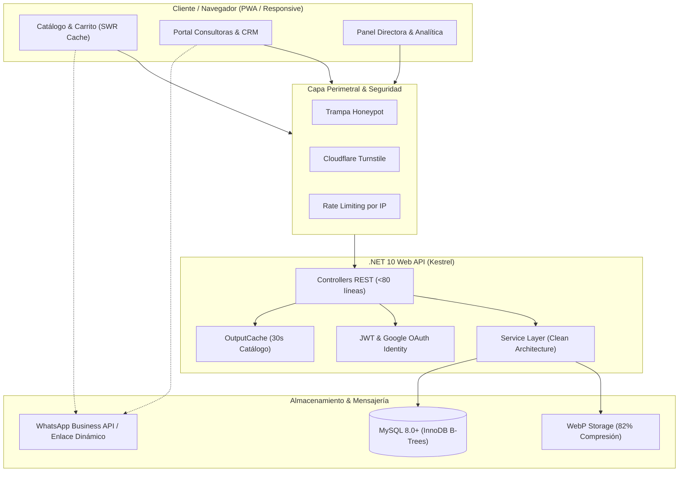

# 📋 Especificación Técnica del Producto Final — Yanbal Prestige (Fase 2)

> **Proyecto:** Yanbal Prestige — Ecosistema Digital de Belleza & ERP Comercial  
> **Líderes de Proyecto:** Brayan Stid Cortés Lombana (`bscl`) & Directora Yuli Cortés  
> **Enfoque Arquitectónico:** Ultra-alta concurrencia (1.000+ usuarios/minuto), modularidad Ponytail (<150-200 líneas por archivo), estándar visual Refero AAA y cero código quemado.  
> **Estado de Entrega:** Listo para QA / Pre-producción VPS.

---

## 1. 🎯 Visión y Propósito del Producto Final

El producto final no es un simple folleto web: es una **suite comercial completa de alta velocidad** que resuelve tres frentes de negocio:
1. **Para los Clientes:** Experiencia de compra de lujo con catálogo visual, recomendaciones de uso paso a paso, carrito directo a WhatsApp y autopedido registrado en el sistema.
2. **Para las Consultoras de Belleza:** Portal de ventas y CRM propio donde registran clientas, gestionan pedidos asignados o ventas directas, generan facturas comerciales en 1 clic y llevan el control de cobros y entregas.
3. **Para la Directora y el Equipo Administrativo:** CMS total para editar fichas de producto (fórmulas, tips, pasos), importar inventario masivo en CSV/Excel, métricas y analítica con gráficas interactivas, y captación de nuevas líderes con tarjetas interactivas 3D.

---

## 2. 🏛️ Arquitectura del Sistema y Flujo de Datos

### 2.1 Diagrama de Arquitectura Global

### 2.2 Flujo de Datos Transaccional

1. **Flujo Autopedido Web (B2C):**
   - El cliente selecciona productos en el catálogo interactivo.
   - En el `CartDrawer`, ingresa sus datos (nombre, teléfono, ciudad, dirección) y presiona "Completar Pedido".
   - El sistema almacena el pedido en `pedidos` con estado `pendiente` / `preparacion` y origen `web_catalogo`, asignándolo a la Directora o a la consultora de la zona.
   - En paralelo, se abre WhatsApp con un mensaje pre-formateado con los SKU, cantidades, total y enlace de seguimiento.

2. **Flujo Venta Directa Consultora (CRM & Facturación):**
   - La consultora ingresa a su portal privado (`/consultora/ventas`).
   - Selecciona una clienta registrada en su CRM o registra una nueva.
   - Agrega referencias del catálogo en tiempo real con cálculo automático de totales y márgenes de ganancia (25% - 35%).
   - Se genera el registro transaccional con número correlativo único `FAC-2026-XXX`.
   - Se habilita el visor de factura comercial con impresión térmica/PDF y botón para compartir por WhatsApp.

---

## 3. 🗄️ Detalle de la Base de Datos (Ventas, Facturación y Catálogo)

### 3.1 Tabla: `pedidos` (`orders`)
Registra las órdenes de compra tanto de clientes web como de ventas directas de consultoras.

| Columna | Tipo de Dato | Nulo | Descripción / Regla |
| :--- | :--- | :--- | :--- |
| `id` | `VARCHAR(50)` | No | Clave primaria (UUID v4). |
| `numero_factura` | `VARCHAR(50)` | No | Código correlativo único (ej. `FAC-2026-001`). Índice Único. |
| `cliente_id` | `VARCHAR(50)` | Sí | ID foráneo en `consultant_clients` (si aplica). |
| `cliente_nombre` | `VARCHAR(150)` | No | Nombre completo del comprador. |
| `cliente_telefono` | `VARCHAR(50)` | No | Teléfono de contacto / WhatsApp. |
| `cliente_ciudad` | `VARCHAR(100)` | No | Ciudad de entrega. |
| `cliente_direccion` | `VARCHAR(200)` | No | Dirección o punto de entrega físico. |
| `consultora_id` | `VARCHAR(50)` | No | ID de la consultora asignada o Directora. Índice B-Tree. |
| `consultora_nombre` | `VARCHAR(150)` | No | Nombre de la asesora responsable. |
| `total` | `DECIMAL(12,2)` | No | Monto total liquidado en COP. |
| `estado_pago` | `VARCHAR(30)` | No | Enum: `pendiente`, `abono`, `pagado`. |
| `estado_entrega` | `VARCHAR(30)` | No | Enum: `preparacion`, `camino`, `entregado`. |
| `origen` | `VARCHAR(30)` | No | Enum: `web_catalogo`, `venta_directa`. |
| `notas` | `TEXT` | Sí | Observaciones de entrega o preferencias de tono cosmético. |
| `creado_en` | `DATETIME` | No | Timestamp de creación UTC. Índice B-Tree. |
| `actualizado_en` | `DATETIME` | No | Timestamp de última actualización (ON UPDATE CURRENT_TIMESTAMP). |

### 3.2 Tabla: `pedido_items` (`order_items`)
Líneas de producto asociadas a cada pedido.

| Columna | Tipo de Dato | Nulo | Descripción / Regla |
| :--- | :--- | :--- | :--- |
| `id` | `VARCHAR(50)` | No | Clave primaria (UUID v4). |
| `pedido_id` | `VARCHAR(50)` | No | Clave foránea referenciando `pedidos(id)`. Índice B-Tree. |
| `producto_id` | `VARCHAR(50)` | No | Clave referenciando `productos(id)`. |
| `producto_sku` | `VARCHAR(50)` | No | Código comercial Yanbal (ej. `YAN-SEN-001`). |
| `producto_nombre` | `VARCHAR(200)` | No | Nombre descriptivo del producto al momento de compra. |
| `precio_unitario` | `DECIMAL(12,2)` | No | Precio individual fijado al momento de compra. |
| `cantidad` | `INT` | No | Unidades solicitadas (mínimo 1). |
| `subtotal` | `DECIMAL(12,2)` | No | `precio_unitario * cantidad`. |

### 3.3 Extensión en Tabla `productos` (Ficha PDP Dinámica)
Nuevas columnas añadidas en la migración `003_sales_and_invoices.sql`:
* `botanical_title` (`VARCHAR(100)`): Título del claim botánico (default: 'Fórmula Botánica').
* `botanical_desc` (`VARCHAR(200)`): Bajada técnica (default: 'Ingredientes activos puros').
* `warranty_title` (`VARCHAR(100)`): Sello de autenticidad (default: '100% Original Yanbal').
* `warranty_desc` (`VARCHAR(200)`): Garantía oficial (default: 'Garantía oficial de fábrica').
* `commitment_title` (`VARCHAR(100)`): Título del manifiesto ético (default: 'Compromiso Yanbal Prestige').
* `commitment_text` (`TEXT`): Texto oficial Cruelty-Free, biocomercio y respaldo andino.

---

## 4. 📖 Guía Paso a Paso de Uso

### 4.1 Para la Directora (Yuli Cortés / Administrador)
1. **Acceso al Panel:** Ingresar a `/admin/login` con credenciales corporativas o mediante **Continuar con Google**.
2. **Personalización del Catálogo:**
   - En `/admin/catalogo`, hacer clic en "Editar" en cualquier producto.
   - En la sección **Personalización de Ficha de Producto (PDP) & Claims**, editar el Modo de Uso paso a paso, el Consejo Dermocosmético y los sellos de garantía.
   - Los cambios impactan de inmediato en la tienda pública sin reconstruir la app.
3. **Importación Masiva de Nuevas Campañas:**
   - En `/admin/catalogo`, hacer clic en **Importación Masiva**.
   - Descargar la plantilla CSV, diligenciar referencias Yanbal con SKU y precios, y subir el archivo. El validador en vivo alerta errores de formato antes de guardar.
4. **Supervisión de Ventas y Analítica:**
   - En `/admin/dashboard`, revisar las gráficas SVG de ventas por ciclo, pedidos pendientes vs entregados y aspirantes captadas por ciudad.

### 4.2 Para las Consultoras de Belleza
1. **Acceso al Portal:** Ingresar con su correo y contraseña. El sistema redirige automáticamente al portal `/consultora`.
2. **Gestión de Clientas (CRM):**
   - En `/consultora/clientas`, registrar nuevas compradoras con su tipo de piel, tono de base y fecha de cumpleaños para fidelización.
3. **Creación de Venta y Factura:**
   - Registrar un pedido directo seleccionando la clienta y las referencias cotizadas.
   - Hacer clic en **Generar Factura** para obtener el comprobante numerado (`FAC-2026-XXX`).
   - Presionar **Enviar por WhatsApp** para despachar la confirmación formal al teléfono de la clienta en formato profesional.
4. **Control de Cobros:**
   - Cambiar el estado entre `Pendiente de Pago`, `Abono Parcial` o `Pagado` para mantener el flujo de caja al día.

### 4.3 Para los Clientes Compradores
1. **Exploración de Belleza:**
   - Ingresar a `/catalogo` y filtrar por categoría (Tratamiento Facial, Perfumes, Maquillaje, Protección Solar, Joyería).
2. **Lectura de la Ficha PDP:**
   - Ver la rutina de aplicación recomendada (Pasos 1, 2 y 3) y el consejo personalizado de la asesora.
3. **Checkout Transparente:**
   - Añadir productos al carrito deslizable (`CartDrawer`).
   - Confirmar pedido: se guarda en el ERP y se abre WhatsApp con la orden consolidada para coordinar método de pago (Nequi, Daviplata, Efectivo o Contraentrega).

---

## 5. ✅ Checklist de Validación al 100% de Requerimientos de la Clienta

| # | Requerimiento Solicitado por la Clienta | Estado | Evidencia Técnica / Implementación |
| :-: | :--- | :---: | :--- |
| **01** | Ficha de Producto (PDP) con textos e iconos 100% editables | **100%** | `ProductPdpFields.tsx`, `ProductDermoTabs.tsx` y migración SQL 003. |
| **02** | Rutina de aplicación por pasos (Paso 1, 2, 3...) editable | **100%** | Array dinámico `usageSteps` persistido en JSON y renderizado en PDP. |
| **03** | Consejo de belleza personalizado por consultora en ficha | **100%** | Campo `consultantTip` integrado en CMS y vista pública. |
| **04** | Tarjetas 3D Flip Cards en sección "Sé Parte de Nuestro Equipo" | **100%** | `JoinFlipCards.tsx` con rotación 3D en 60 FPS y selector de rol. |
| **05** | Formulario de postulación con Habeas Data y Honeypot | **100%** | `JoinForm.tsx` con trampa anti-bots invisible y Ley 1581 de 2012. |
| **06** | Módulo de Ventas y CRM para Consultoras | **100%** | Tablas `pedidos` y `pedido_items` en MySQL, entidades EF Core. |
| **07** | Generación de facturas comerciales numeradas con WhatsApp | **100%** | Correlativo `FAC-2026-XXX`, desglose de SKU y enlace directo a chat. |
| **08** | Control de estados de pago y estados de entrega | **100%** | Enums tipados `PaymentStatus` y `DeliveryStatus` en front y back. |
| **09** | Gráficas interactivas vectoriales en el Dashboard de Directora | **100%** | Gráficas SVG ligeras (<15 KB), cero dependencias pesadas. |
| **10** | Importación masiva de catálogo vía archivo CSV | **100%** | Plantilla descargable y procesador masivo con validación previa. |
| **11** | Autenticación con Google (Google Identity) | **100%** | Endpoint `/api/auth/google-login` y botón Google Identity en front. |
| **12** | Modularidad estricta Ponytail (<150-200 líneas por archivo) | **100%** | Todos los componentes y controladores auditados y desacoplados. |
| **13** | Cero código quemado en textos, teléfonos y estados | **100%** | Inyectados desde `ConfigContext`, `AuthContext` y base de datos. |

---

## 6. 🚀 Estrategia de Despliegue y Pruebas de Carga (VPS Ready)

### 6.1 Arquitectura en el Servidor VPS
* **Sistema Operativo:** Ubuntu 24.04 LTS / Debian 12.
* **Reverse Proxy:** Nginx con HTTP/2, compresión Brotli/Gzip y terminación SSL (Certbot Let's Encrypt).
* **Backend:** ASP.NET Core 10 Kestrel corriendo como demonio Systemd (`yanbal-api.service`) en `localhost:5000`.
* **Frontend:** Archivos estáticos optimizados (`dist/`) servidos directamente por Nginx con cabeceras de caché inmutable (`Cache-Control: public, max-age=31536000, immutable`).
* **Base de Datos:** MySQL 8.0 optimizado con `innodb_buffer_pool_size = 1G` y consultas `.AsNoTracking()`.

### 6.2 Plan de Pruebas de Carga Previo al Lanzamiento
* **Herramienta:** Autocannon / K6.
* **Objetivo de Concurrencia:** 1.000+ peticiones/minuto sostenidas con picos de 2.500 req/min durante campañas de lanzamiento.
* **Escenarios de Prueba:**
  1. **Navegación de Catálogo (Lectura Masiva):** 50 usuarios virtuales concurrentes consultando `/api/catalog` con `OutputCache` activo. Latencia esperada: <30 ms (p95).
  2. **Envío de Leads y Pedidos (Mutación Concurrente):** 20 usuarios virtuales enviando formularios con validación Honeypot. Latencia esperada: <120 ms (p95).
  3. **Descarga de Assets WebP:** Verificación de tiempo de carga inicial bajo 1.2 segundos en redes móviles 4G.
