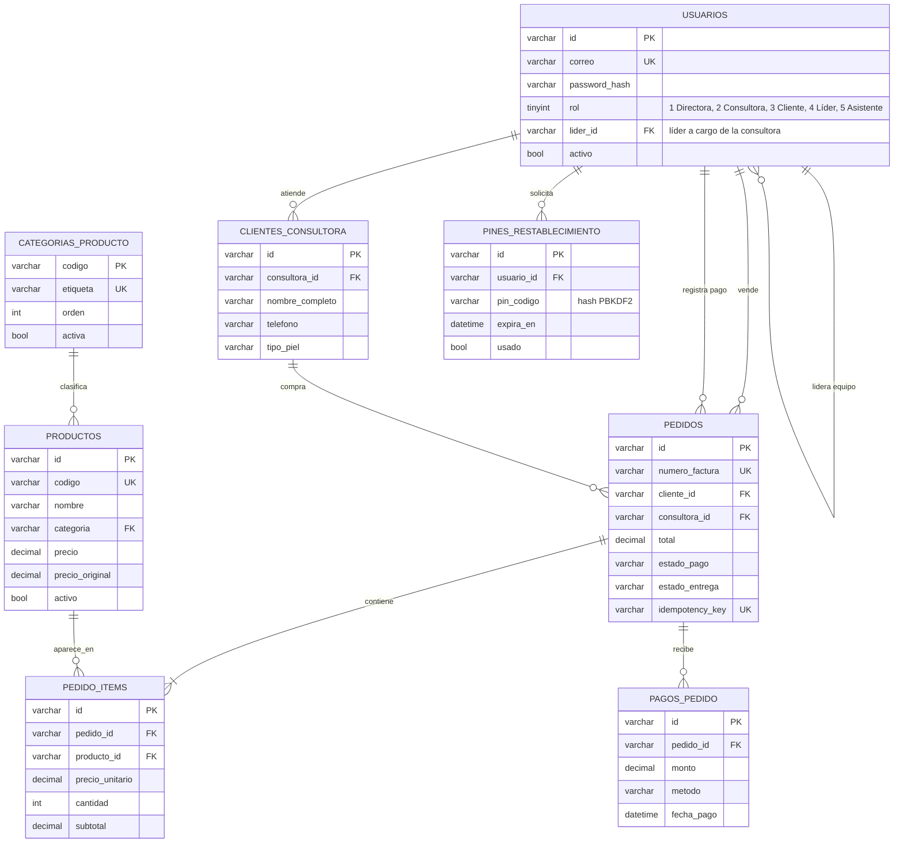

# MER y modelo de datos atómico en 3FN — Yanbal Prestige

> Documento de referencia del esquema `database/005_atomic_3nf_canonical.sql`.
> Motor: MySQL 8.0+ / InnoDB / `utf8mb4_unicode_ci`.

## 1. Diagrama entidad-relación



## 2. Por qué este modelo está en 3FN

### 2.1 Primera forma normal (1FN)

- Todas las columnas son atómicas: no hay listas separadas por comas ni
  arreglos empaquetados en celdas.
- `productos.modo_uso_json` guarda un documento JSON, pero **no se consulta
  por partes**: se usa como un atributo opaco de presentación. Si en el futuro
  se necesita filtrar por paso, se normaliza a `producto_pasos_uso`.
- Cada tabla tiene clave primaria declarada.

### 2.2 Segunda forma normal (2FN)

- Las claves primarias son simples (`VARCHAR(50)`), por lo que no existen
  dependencias parciales posibles en `pedido_items` ni en ninguna otra tabla.
- `pedido_items` identifica la línea con `id`, y protege la combinación
  natural con `UNIQUE (pedido_id, producto_id)` para impedir duplicados.

### 2.3 Tercera forma normal (3FN)

La corrección principal está en el catálogo:

| Antes (004) | Problema | Ahora (005) |
| :--- | :--- | :--- |
| `productos.categoria_label` repetido en cada producto | `categoria → categoria_label` es una dependencia transitiva (viola 3FN) | `categorias_producto(etiqueta)` + `productos.categoria` como FK |
| Roles como texto libre en `trabajadores.rol` | Valores inconsistentes (`DIRECTORA`, `directora`, `Admin`) | `usuarios.rol TINYINT` con `CHECK (rol IN (1,2,3))` |
| Estados sin restricción | Cualquier cadena entraba en `estado_pago` | `CHECK` con vocabulario cerrado |
| PIN en claro | Filtración = toma de cuenta | `pin_codigo` almacena hash PBKDF2 |

Dependencias funcionales resultantes:

```
codigo            → etiqueta, orden, activa        (categorias_producto)
id                → codigo, nombre, categoria, …    (productos)
correo            → id, password_hash, rol, …       (usuarios)
id                → pedido_id, producto_id, …       (pedido_items)
(pedido_id, producto_id) → id                       (clave candidata de pedido_items)
```

No queda ningún atributo no clave que dependa de otro atributo no clave.

### 2.4 Jerarquía de roles de la red

| Rol | Valor | Alcance | Vende | Equipo a cargo |
| :--- | :---: | :--- | :---: | :---: |
| Administradora / Directora | 1 | Toda la red, catálogo, CMS, usuarios y prospectos | Sí | Toda la red |
| Consultora / Vendedora | 2 | Su cartera y sus pedidos | Sí | No |
| Cliente | 3 | Catálogo y sus propios datos | Compra | No |
| Líder de zona | 4 | Su cartera + las consultoras de su `lider_id` | Sí | Sí |
| Asistente administrativa | 5 | Catálogo, CMS, anuncios, prospectos y ventas | No | No |

Regla de negocio: el líder de zona **vende igual que una consultora** y lo único
adicional es que tiene trabajadoras a cargo. Por eso su `lider_id` es `NULL`
(no reporta a otro líder) y las consultoras sí pueden tener `lider_id`.
La restricción `chk_usuarios_lider_rol` impide asignar líder a un rol que no
sea consultora.

## 3. Excepciones documentadas (desnormalización intencional)

Una factura es un documento histórico. Si la clienta cambia de teléfono o la
consultora cambia de nombre, la factura **no debe cambiar**. Por eso se
conservan instantáneas:

| Campo | Motivo |
| :--- | :--- |
| `pedidos.cliente_nombre`, `cliente_telefono`, `cliente_ciudad`, `cliente_direccion` | Datos de contacto al momento de la venta |
| `pedidos.consultora_nombre` | Nombre de quien vendió en ese momento |
| `pedido_items.producto_sku`, `producto_nombre`, `precio_unitario` | Precio y nombre congelados (integridad tributaria) |

Estas columnas no son dependencias transitivas: son **atributos históricos**
del hecho "pedido", no del producto ni de la clienta actual.

## 4. Integridad que la base de datos garantiza

1. **Llaves foráneas** en todas las relaciones:
   - `productos.categoria → categorias_producto.codigo` (RESTRICT).
   - `clientes_consultora.consultora_id → usuarios.id` (RESTRICT).
   - `pedidos.cliente_id → clientes_consultora.id` (SET NULL, la factura sobrevive).
   - `pedidos.consultora_id → usuarios.id` (RESTRICT).
   - `pedido_items.pedido_id → pedidos.id` (CASCADE).
   - `pedido_items.producto_id → productos.id` (RESTRICT).
   - `pagos_pedido.pedido_id → pedidos.id` (CASCADE).
   - `pines_restablecimiento.usuario_id → usuarios.id` (CASCADE).
2. **Unicidad**: correo, código de producto, número de factura, clave de
   idempotencia y combinación pedido/producto.
3. **Dominios cerrados** con `CHECK`: rol, estados, origen, modalidad,
   cantidades (1–99) y montos positivos.
4. **Atomicidad de totales** con triggers:
   - `trg_items_subtotal_bi/bu` recalcula `subtotal = precio × cantidad`.
   - `trg_items_total_ai/au/ad` recalcula `pedidos.total` tras cada cambio.
   Así el total nunca puede diferir de la suma de sus líneas, incluso si un
   script externo intenta escribirlo a mano.

## 5. Correspondencia con el backend (EF Core)

| Entidad C# | Tabla | Nota |
| :--- | :--- | :--- |
| `Product` | `productos` | `CategoryLabel` es `[NotMapped]`, se resuelve con `Include(CategoryRef)` |
| `ProductCategory` | `categorias_producto` | Nueva entidad de la normalización |
| `User` | `usuarios` | `rol` entero (enum `UserRole`) |
| `ConsultantClient` | `clientes_consultora` | Cartera por consultora |
| `PasswordResetPin` | `pines_restablecimiento` | `pin_codigo` = hash PBKDF2 |
| `Order` | `pedidos` | Totales derivados por trigger y por el servicio |
| `OrderItem` | `pedido_items` | Snapshots históricos de SKU/nombre/precio |
| `LeadProspect` | `prospectos_unete` | Honeypot y Habeas Data |
| `Tip` | `cms_tips` | — |
| `HeroSlide` | `cms_hero_slides` | — |
| `DigitalCatalog` | `cms_catalogo_digital` | — |
| `VideoTip` | `cms_video_tips` | — |
| `EventItem` | `eventos` | `modalidad` 1/2 |

`pagos_pedido` y `auditoria_eventos` son extensiones preparadas para la
siguiente fase; el backend puede adoptarlas sin romper el esquema actual.

## 6. Cómo aplicar el esquema

```powershell
# Requiere el cliente mysql y credenciales con permiso de creación
mysql -u root -p < database/005_atomic_3nf_canonical.sql
```

Si la base ya existe creada por `EnsureCreated()` (con `categoria_label`),
hay dos rutas:

1. **Recomendada (entorno nuevo):** crear la base vacía y ejecutar 005 antes
   de arrancar la API; `DbInitializer` siembra usuarios, categorías y productos.
2. **Base existente:** migrar con un script `ALTER` controlado:
   ```sql
   INSERT INTO categorias_producto (codigo, etiqueta)
   SELECT DISTINCT categoria, categoria_label FROM productos;

   ALTER TABLE productos
     ADD CONSTRAINT fk_productos_categoria
     FOREIGN KEY (categoria) REFERENCES categorias_producto(codigo);

   ALTER TABLE productos DROP COLUMN categoria_label;
   ```
   (Hacer respaldo antes; `EnsureCreated` no aplica migraciones automáticas.)

## 7. Checklist de validación del modelo

- [x] Cada tabla tiene PK.
- [x] No hay grupos repetidos (1FN).
- [x] No hay dependencias parciales (2FN).
- [x] No hay dependencias transitivas (3FN), salvo snapshots históricos documentados.
- [x] Toda relación N:M está resuelta con tabla intermedia (`pedido_items`).
- [x] Llaves foráneas con política de borrado explícita.
- [x] Dominios cerrados con `CHECK`.
- [x] Totales derivados y protegidos por trigger.
- [x] PIN y contraseñas almacenados con hash.
- [x] Índices en columnas de búsqueda y filtro (correo, fecha, estado, consultora).
