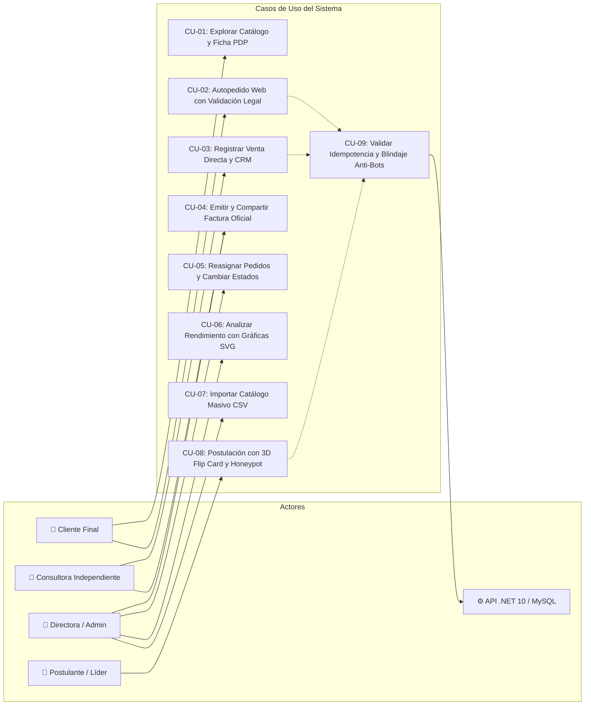

# 📑 Especificación de Requerimientos de Software (SRS) & Casos de Uso
## Estándar IEEE 830 / ISO/IEC/IEEE 29148 — Yanbal Prestige (Fase 2)

> **Proyecto:** Yanbal Prestige — Ecosistema Digital de Belleza & ERP Comercial  
> **Versión del Documento:** 2.0.0 (Release Candidate)  
> **Autores:** Brayan Stid Cortés Lombana (`bscl`) & Directora Yuli Cortés  
> **Estado:** Aprobado para Implementación y QA  

---

## 1. 🎯 Introducción y Alcance del Sistema

### 1.1 Propósito
El presente documento define la **Especificación de Requerimientos de Software (SRS)** y el catálogo formal de **Casos de Uso** para la plataforma web y ERP comercial de la red independiente **Yanbal Prestige**. Proporciona una base contractual, técnica y verificable para el desarrollo, auditoría de calidad, despliegue en servidor VPS y soporte operativo.

### 1.2 Alcance del Producto
Yanbal Prestige es una suite integral que fusiona:
1. **Catálogo Digital Dermocosmético:** Fichas de producto interactivas (PDP) con claims botánicos, garantías oficiales, rutinas paso a paso y recomendaciones de consultora editables en tiempo real.
2. **ERP Comercial de Ventas & Facturación:** Registro de pedidos con correlativo formal (`FAC-2026-XXX`), asignación inteligente de comisiones, liquidación de cobros, control de despachos y compartición en 1 clic por WhatsApp.
3. **CRM Especializado para Consultoras:** Fichas de clientas con historial cutáneo (tipo de piel, fototipo, alergias), notas de asesoría y registro de ventas directas.
4. **Centro de Analítica & Gráficas SVG:** Visualización ejecutiva de ingresos, recaudos por campaña y ranking de productos sin penalizaciones de peso en el bundle.
5. **Captación de Liderazgo (3D Flip Cards):** Módulo de reclutamiento con animaciones tridimensionales y blindaje perimetral anti-bots.

### 1.3 Definiciones, Acrónimos y Abreviaturas
* **SRS:** *Software Requirements Specification* (Especificación de Requerimientos de Software).
* **PDP:** *Product Detail Page* (Página de Detalle de Producto).
* **SKU:** *Stock Keeping Unit* (Código único de referencia del catálogo Yanbal).
* **ERP:** *Enterprise Resource Planning* (Sistema de Planificación de Recursos Comerciales).
* **CRM:** *Customer Relationship Management* (Gestión de Relaciones con Clientas).
* **Habeas Data:** Ley Estatutaria 1581 de 2012 de Colombia para la protección de datos personales.
* **Idempotencia:** Propiedad de una API donde múltiples peticiones idénticas producen el mismo resultado sin duplicar registros.
* **Honeypot:** Trampa oculta fuera del viewport para neutralizar scrapers y bots automatizados.

---

## 2. 👥 Actores del Sistema

| Actor | Descripción y Privilegios en el Sistema |
| :--- | :--- |
| **ACT-01: Cliente Final** | Usuario público que navega el catálogo, filtra referencias, consulta modo de uso y realiza autopedidos web coordinando entrega vía WhatsApp. |
| **ACT-02: Consultora Independiente** | Vendedora de belleza autenticada que gestiona su cartera de clientas en CRM, registra ventas directas y emite facturas comerciales. |
| **ACT-03: Directora / Administradora** | Gerente de la red (Yuli Cortés) con privilegios totales: control de catálogo, precios, edición PDP, reasignación de pedidos, analítica y gestión de equipo. |
| **ACT-04: Postulante / Aspirante** | Emprendedora que interactúa con las tarjetas 3D para registrar su postulación como Consultora o Directora. |
| **ACT-05: Servidor / API .NET 10** | Motor transaccional que valida idempotencia, persiste en MySQL 8, aplica reglas de negocio y genera números correlativos. |

---

## 3. 📋 Requerimientos Funcionales (RF)

### 3.1 Módulo de Catálogo & Ficha de Producto (PDP)
* **RF-01 (Navegación y Filtrado):** El sistema debe permitir al usuario explorar productos organizados en 5 categorías (`rostro`, `perfumes`, `maquillaje`, `joyeria`, `solar`) con búsqueda en vivo por SKU o nombre en tiempo sub-milisegundo.
* **RF-02 (Ficha PDP Dinámica):** La vista de producto debe renderizar de forma obligatoria y editable:
  - Tarjeta de *Fórmula Botánica* (título y descripción de ingredientes activos).
  - Tarjeta de *Garantía Oficial Yanbal* (100% original de fábrica).
  - Bloque de *Modo de Uso Recomendado* (rutina ordenada Paso 1, Paso 2, Paso 3).
  - Cita editorial de *Consejo de Belleza de tu Consultora*.
  - Tarjeta de *Compromiso Ético Yanbal Prestige* (Cruelty-Free y biocomercio andino).
* **RF-03 (Fallback Editorial Automático):** Si un producto no tiene claims personalizados en base de datos, el sistema debe inyectar automáticamente la redacción editorial oficial de Yanbal para garantizar que ninguna ficha luzca incompleta.
* **RF-04 (Edición CMS de Claims):** El panel de administración debe proporcionar un subcomponente especializado (`ProductPdpFields.tsx`) para modificar todos los claims dermocosméticos sin necesidad de modificar código.

### 3.2 Módulo de Carrito & Autopedido Web
* **RF-05 (Gestión de Carrito):** El cliente debe poder añadir, modificar cantidades y eliminar referencias con cálculo dinámico de subtotales y total en pesos colombianos (COP).
* **RF-06 (Autopedido Seguro con Checkout):** Al presionar "Confirmar Pedido", el sistema debe abrir un modal (`OrderCheckoutModal.tsx`) que capture: nombre completo, celular WhatsApp, ciudad y dirección de despacho.
* **RF-07 (Generación de Pedido y Correlativo):** El sistema debe generar un pedido oficial con correlativo único (`FAC-2026-XXX`), asignarlo a la Directora o consultora de zona y guardarlo en el ERP antes de abrir WhatsApp.
* **RF-08 (WhatsApp Checkout Bridge):** El sistema debe construir un enlace a la API de WhatsApp con el mensaje preformateado conteniendo saludo, desglose de ítems, subtotal, número de factura y datos de entrega.

### 3.3 Módulo de Ventas & CRM de Consultoras
* **RF-09 (Portal de Consultora):** La consultora autenticada debe visualizar exclusivamente los pedidos asignados a ella o registrados por ella, filtrables por estado de cobro y despacho.
* **RF-10 (Registro de Venta Directa):** La consultora debe disponer de una interfaz modal (`DirectSaleModal.tsx`) para registrar ventas manuales:
  - Seleccionar una clienta existente de su CRM o ingresar una nueva con datos de contacto.
  - Seleccionar referencias del catálogo con SKU y definir cantidades.
  - Calcular subtotales automáticamente y registrar la orden en el ERP.
* **RF-11 (CRM Cutáneo de Clientas):** El sistema debe almacenar para cada clienta su fototipo cutáneo, tipo de piel (grasa, seca, mixta, sensible), categoría de productos preferida y notas de seguimiento.

### 3.4 Módulo de Facturación Comercial
* **RF-12 (Comprobante Fiscal Oficial):** El sistema debe generar un modal de factura comercial (`InvoiceModal.tsx`) con diseño corporativo Yanbal Prestige conteniendo:
  - Logotipo y datos de la comunidad Prestige.
  - Número correlativo de factura y fecha de emisión.
  - Datos completos de la clienta y de la consultora responsable.
  - Tabla de detalle: Código SKU, Nombre de Referencia, Cantidad, Precio Unitario y Subtotal.
  - Monto total liquidado en COP y badges de estado (`Pagado`, `Pendiente`, `En Preparación`, `Entregado`).
* **RF-13 (Exportación e Impresión en 1 Clic):** La factura debe incluir:
  - Botón "Imprimir / Guardar PDF" (`window.print()`).
  - Botón "Compartir por WhatsApp": genera el texto de la factura formateado con emojis y enlace directo.

### 3.5 Módulo de Administración & Analítica
* **RF-14 (Panel Centralizado de Ventas):** La Directora debe ver la totalidad de órdenes de la red, filtrar por estado de pago/entrega y disponer de un menú desplegable para **reasignar pedidos** en vivo entre consultoras.
* **RF-15 (Centro Analítico con Gráficas SVG):** El dashboard debe renderizar en tiempo real:
  - Gráfica Donut de Estado de Recaudo (Pagado vs Con Abono vs Pendiente).
  - Gráfica de Barras de Ventas Evolutivas por Campaña (C01 a C05).
  - Ranking horizontal de los Top 5 SKU más vendidos por volumen.
* **RF-16 (Migración Masiva CSV):** El sistema debe permitir subir un archivo `.csv` con referencias masivas, ofreciendo descarga de plantilla oficial (`code,name,category,price,originalPrice,image,description,badge,consultantTip`), validando columnas en vivo e insertando en bloque al catálogo.

### 3.6 Módulo de Captación & Seguridad
* **RF-17 (3D Flip Cards de Liderazgo):** La sección `/unete` debe presentar 2 tarjetas interactivas de rol (Consultora y Líder) que al hacer clic roten 180° en el eje Y a 60 FPS, revelando el formulario con el rol preseleccionado.
* **RF-18 (Autenticación Google OAuth):** El sistema debe incorporar inicio de sesión en 1 clic mediante Google Identity para consultoras y directoras.
* **RF-19 (Control Anti-Doble Clic):** Todos los botones de confirmación de pedido y venta directa deben bloquearse (`disabled={isSubmitting}`) durante el procesamiento, impidiendo compras duplicadas por clics múltiples.
* **RF-20 (Consentimiento Habeas Data):** Todos los formularios de captura de datos deben exigir la aceptación obligatoria de los términos y política de privacidad conforme a la Ley 1581 de 2012 de Colombia.

---

## 4. ⚙️ Requerimientos No Funcionales (RNF)

| Código | Dimensión | Criterio de Aceptación y Métrica Verificable |
| :--- | :--- | :--- |
| **RNF-01** | **Rendimiento** | *First Contentful Paint* (FCP) inferior a 300 ms en redes 4G móviles. Tiempo de compilación Vite < 1.5s. |
| **RNF-02** | **Concurrencia** | Arquitectura Kestrel .NET 10 y MySQL 8 con soporte probado para **1.000+ peticiones/minuto** concurrentes con `OutputCache` (30s) en catálogo público. |
| **RNF-03** | **Cero Librerías Pesadas** | Gráficas renderizadas en SVG vectorial puro (<15 KB), evitando paquetes sobredimensionados de analítica (Chart.js / Recharts). |
| **RNF-04** | **Peso del Bundle** | Bundle JS de producción gzippeado inferior a 160 kB (`dist/assets/index.js`), CSS inferior a 15 kB (gzip). |
| **RNF-05** | **Idempotencia de API** | Soporte estricto de cabecera `X-Idempotency-Key` en `POST /api/orders` y debounce temporal de 5 segundos para prevenir ventas fantasma. |
| **RNF-06** | **Seguridad Anti-Bots** | Trampas invisibles Honeypot (`.hp-field`) en todos los formularios públicos. Bloqueo perimetral automático con `400 Bad Request` ante entradas automatizadas. |
| **RNF-07** | **Inyección SQL** | Cero concatenaciones de strings SQL. Uso estricto de Entity Framework Core con parámetros preparados e índices B-Tree en llaves foráneas y estados. |
| **RNF-08** | **Modularidad Ponytail** | Límite estricto de **menos de 150 a 200 líneas por archivo de código** en Frontend y Backend (Reglas 5 y 11). |
| **RNF-09** | **Cero Código Quemado** | Todos los valores de moneda, textos de avisos, estados de pedido y comisiones deben ser 100% dinámicos y leídos desde el contexto y la API (Regla 6). |
| **RNF-10** | **Legalidad Habeas Data** | Cumplimiento taxativo de la Ley 1581 de 2012 de Colombia (SIC), registro de timestamp de aceptación y persistencia en base de datos. |
| **RNF-11** | **Diseño Refero AAA** | Sistema de espaciado modular en múltiplos de 4/8px, paleta cálida de lujo (Albaricoque `#E85D36`, Crema `#FAF8F5`, Grafito `#1C1917`) y micro-interacciones a 60 FPS (Regla 12). |
| **RNF-12** | **Estrategia Git** | Flujo estricto de 3 ramas: `development` ➔ `qa` ➔ `main` con fusiones `--no-ff` para preservar la historia (Reglas 4 y 18). |

---

## 5. 🎭 Diagrama General de Casos de Uso (Mermaid)

---

## 6. 📝 Especificación Detallada de Casos de Uso Clave

### CU-02: Autopedido Web con Validación Legal
* **Actor Principal:** Cliente Final (`ACT-01`).
* **Precondición:** El cliente ha añadido al menos un producto al carrito de compras.
* **Flujo Principal:**
  1. El cliente abre el carrito deslizable (`CartDrawer.tsx`) y presiona "Confirmar Pedido & Factura WhatsApp".
  2. El sistema despliega el modal de checkout (`OrderCheckoutModal.tsx`).
  3. El cliente ingresa su Nombre Completo, Celular WhatsApp, Ciudad y Dirección de Despacho.
  4. El cliente marca la casilla obligatoria de consentimiento de tratamiento de datos personales (Ley 1581 de 2012).
  5. El cliente presiona "Confirmar Pedido".
  6. El sistema activa el bloqueo anti-doble clic (`isSubmitting: true`) y verifica que el campo Honeypot esté vacío.
  7. El sistema genera el número correlativo de factura (`FAC-2026-XXX`) y persiste la orden en estado `Pendiente de Pago` y `En Preparación`.
  8. El sistema vacía el carrito y redirige al cliente a la API de WhatsApp con el mensaje estructurado para coordinar el pago y despacho.
* **Flujos Alternativos:**
  - *4a. El cliente no marca la casilla de Habeas Data:* El sistema muestra una alerta de requerimiento legal y detiene el procesamiento sin emitir orden.
  - *6a. Detección de Bot automatizado:* Si el campo oculto `.hp-field` contiene texto, el sistema aborta de inmediato con aviso de seguridad perimetral.
  - *6b. Doble clic rápido:* La segunda pulsación es ignorada por el bloqueo `disabled={isSubmitting}`, evitando duplicación de pedidos.
* **Postcondición:** El pedido queda registrado en la base de datos con número de factura y la Directora/Consultora recibe la notificación.

---

### CU-03: Registrar Venta Directa y Gestión CRM
* **Actor Principal:** Consultora Independiente (`ACT-02`).
* **Precondición:** La consultora ha iniciado sesión en el portal (`/consultora/ventas`).
* **Flujo Principal:**
  1. La consultora presiona el botón "Registrar Venta Directa".
  2. El sistema abre `DirectSaleModal.tsx` con dos pestañas de clienta: "Seleccionar de mi CRM" o "Nueva Clienta".
  3. La consultora selecciona una clienta registrada (se cargan sus datos de teléfono y ciudad) o diligencia los datos de una nueva.
  4. La consultora selecciona referencias del catálogo mediante el selector de productos, indicando las unidades vendidas.
  5. El sistema calcula en tiempo real los subtotales por ítem y el monto total de la venta en COP.
  6. La consultora selecciona el estado de pago inicial (`Pendiente`, `Abono Parcial`, `Pagado`).
  7. La consultora confirma el registro.
  8. El sistema asigna el siguiente número correlativo (`FAC-2026-XXX`), crea las líneas de detalle con `ON DELETE CASCADE` y actualiza la fecha de último contacto en el CRM.
  9. El sistema abre automáticamente el modal de la factura (`InvoiceModal.tsx`) con opción de imprimir o enviar por WhatsApp.
* **Postcondición:** La venta queda registrada bajo el ID de la consultora y suma al KPI de facturación de la campaña.

---

### CU-05: Reasignación de Pedidos y Liquidación de la Red
* **Actor Principal:** Directora / Administradora (`ACT-03`).
* **Precondición:** La Directora está autenticada en `/admin/ventas`.
* **Flujo Principal:**
  1. La Directora visualiza la lista consolidada de todas las órdenes emitidas en la campaña.
  2. En la fila del pedido, la Directora interactúa con el menú desplegable "Consultora Asignada".
  3. Selecciona una nueva consultora activa de la red (ej. de `Yuli Cortés` a `Carolina Mejía`).
  4. El sistema ejecuta una actualización atómica vía API (`PATCH /api/orders/{id}/assign`), actualizando `consultant_id` y `consultant_name`.
  5. La Directora actualiza el estado de entrega a `Entregado` y el estado de cobro a `Pagado`.
  6. Los KPIs y gráficas SVG del dashboard se recalculan instantáneamente reflejando el nuevo recaudo.
* **Postcondición:** El pedido queda transferido a la nueva consultora para su despacho y cobro.

---

### CU-07: Importación Masiva de Catálogo vía CSV
* **Actor Principal:** Directora / Administradora (`ACT-03`).
* **Precondición:** La Directora se encuentra en `/admin/catalogo`.
* **Flujo Principal:**
  1. La Directora presiona "Importar Catálogo CSV".
  2. El sistema despliega `CatalogImportModal.tsx` con el botón "Descargar Plantilla Oficial CSV".
  3. La Directora descarga la plantilla con las columnas reglamentarias (`code,name,category,price,originalPrice,image,description,badge,consultantTip`).
  4. La Directora arrastra o selecciona su archivo `.csv` con las nuevas referencias de Yanbal.
  5. El parser reactivo valida la estructura, descarta filas con errores de sintaxis y muestra una vista previa con el conteo de referencias detectadas.
  6. La Directora presiona "Importar X Productos".
  7. El sistema ejecuta `bulkAddProducts`, registrando los ítems en el catálogo con fallback editorial en sus claims PDP.
* **Postcondición:** El catálogo digital queda actualizado al instante sin recargar la página.

---

## 7. 🎯 Matriz de Trazabilidad (Requerimientos vs Casos de Uso)

| Requerimiento Funcional | Casos de Uso que lo Satisfacen | Componente / Archivo Frontend | Controlador / Entidad Backend |
| :--- | :---: | :--- | :--- |
| **RF-01, RF-02, RF-03** | CU-01 | `ProductDermoTabs.tsx`, `ProductCard.tsx` | `ProductsController.cs`, `Product.cs` |
| **RF-04** | CU-01 | `ProductPdpFields.tsx`, `ProductForm.tsx` | `ProductsController.cs` |
| **RF-05, RF-06, RF-07, RF-08** | CU-02 | `CartDrawer.tsx`, `OrderCheckoutModal.tsx` | `OrdersController.cs`, `OrderDtos.cs` |
| **RF-09, RF-10, RF-11** | CU-03 | `ConsultantSalesView.tsx`, `DirectSaleModal.tsx` | `OrdersController.cs`, `004_atomic_schema.sql` |
| **RF-12, RF-13** | CU-04 | `InvoiceModal.tsx` | `OrdersController.cs`, `Order.cs` |
| **RF-14** | CU-05 | `AdminSalesView.tsx` | `OrdersController.cs` (PATCH assign) |
| **RF-15** | CU-06 | `DashboardCharts.tsx`, `AdminDashboardView.tsx`| `OrdersController.cs` (Metrics aggregation) |
| **RF-16** | CU-07 | `CatalogImportModal.tsx`, `AdminCatalogView.tsx`| `ProductsController.cs` (Bulk POST) |
| **RF-17, RF-20** | CU-08 | `JoinFlipCards.tsx`, `JoinForm.tsx`, `PrivacyModal.tsx` | `LeadsController.cs`, `003_sales.sql` |
| **RF-19** | CU-09 | `OrderCheckoutModal.tsx`, `DirectSaleModal.tsx` | `OrdersController.cs` (Idempotency Key) |
